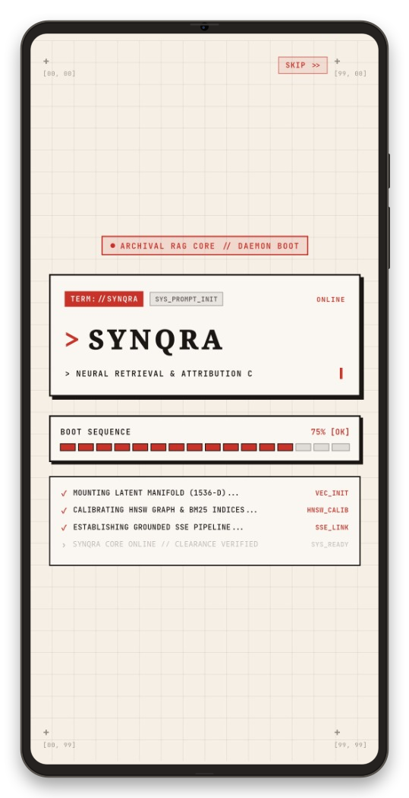
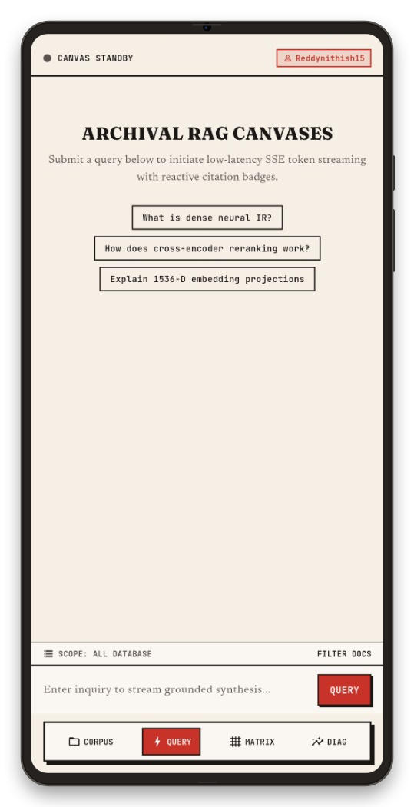
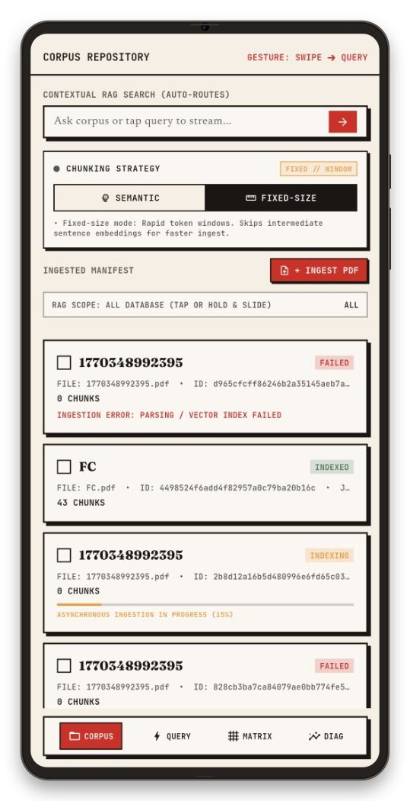
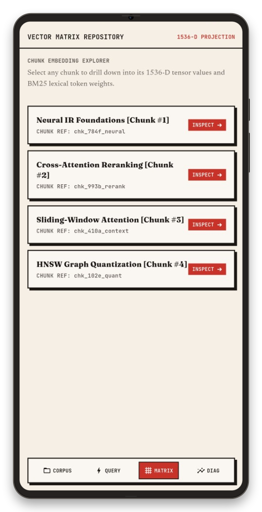
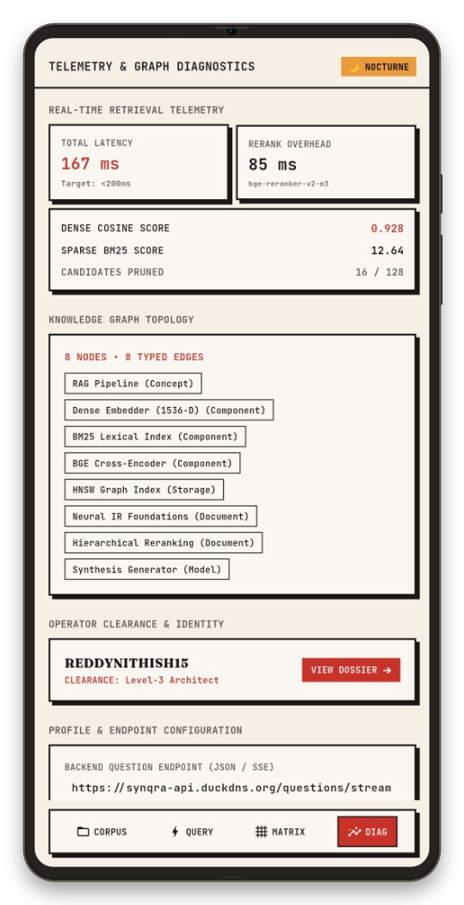

# SYNQRA // Neural Retrieval & Attribution Canvas

> **A high-performance, neo-brutalist Archival RAG client engineered in Flutter. Features low-latency Server-Sent Events (SSE) streaming, granular document-scoped vector retrieval, grounded citation deep linking, and real-time agentic thought telemetry.**

---

<p align="center">
  <a href="https://flutter.dev"></a>
  <a href="https://dart.dev"></a>
  <a href="docs/design-system.md"></a>
  <a href="docs/auth.md"></a>
  <a href="docs/cloudwatch.md"></a>
  <a href="docs/testing.md"></a>
  <a href="https://nithishkumar2022020.github.io/Synqra/"></a>
  <a href="LICENSE"></a>
</p>

---

> [!NOTE]
> ### 📖 Comprehensive Documentation on MkDocs
> All detailed architectural blueprints, API specifications, AWS Cognito SRP authentication flows, design token tables, and test coverage guides have been migrated to the dedicated **MkDocs Documentation Site**:
> 
> - **🌐 Online Documentation**: **[https://nithishkumar2022020.github.io/Synqra/](https://nithishkumar2022020.github.io/Synqra/)**
> - **💻 Local Server**: Run `mkdocs serve` and visit **[http://localhost:8000](http://localhost:8000)**
>
> **Quick Links to Documentation Chapters:**
> - [📱 Application Canvases Walkthrough](docs/canvases.md)
> - [🏗️ Clean Architecture Blueprint & State Management](docs/architecture.md)
> - [🔐 AWS Cognito Direct SRP Authentication](docs/auth.md)
> - [📡 AWS CloudWatch Telemetry & Audit Stream](docs/cloudwatch.md)
> - [🌐 Backend REST & SSE EventStream API Contract](docs/api.md)
> - [🎨 Neo-Brutalist Design Tokens & Typography](docs/design-system.md)
> - [🚀 Getting Started & Android Deployment](docs/getting-started.md)
> - [🧪 Testing Suite & Quality Assurance (68 Tests)](docs/testing.md)

---

## 📱 Application Canvases Showcase

SYNQRA rejects sterile, opaque chatbots in favor of an **archival research instrument** designed for complete provenance and grounded attribution.

| 🚀 01. Typewriter Boot | 💬 02. Neural Query Canvas | 📚 03. Corpus Repository | 🧬 04. Vector Matrix | 📡 05. Graph Telemetry |
|:---:|:---:|:---:|:---:|:---:|
| <a href="docs/screenshots/mock_01_archival_boot.png"></a> | <a href="docs/screenshots/mock_02_query_canvas.png"></a> | <a href="docs/screenshots/mock_03_corpus_repository.png"></a> | <a href="docs/screenshots/mock_04_vector_matrix.png"></a> | <a href="docs/screenshots/mock_05_graph_telemetry.png"></a> |
| **Terminal Daemon Init**<br>Kinetic boot animation with vector manifold mounting | **Attribution Canvas**<br>Live SSE token stream with interactive citation chips (`[1]`, `[2]`) | **Corpus & Ingestion**<br>PDF multipart uploads, chunking mode switch & slide scope selection | **Latent Space (1536-D)**<br>Vector manifold & per-chunk tensor inspection | **Real-Time Telemetry**<br>Dense/BM25 scores, HNSW topology & operator clearance |

---

## ⚡ Core Capabilities

- **⚡ Real-Time SSE Token Streaming**: Incremental response streaming over HTTP Server-Sent Events (`POST /questions/stream`) with atomic event models and HTTP fallback.
- **🎯 Interactive Grounded Citations**: Claims are paired with hyperlinked citation chips (`[1]`, `[2]`) that expand into modal sheets with source text, document ID, and page references.
- **🔬 Agentic Thought Timeline**: Surfaces every retrieval phase (*Query Preparation → Embedding Generation → HNSW Traversal → Cross-Encoder Reranking → Grounded Synthesis*).
- **📂 Multi-Document Scoping**: Touch or slide across document cards in the **Corpus Repository** to restrict vector retrieval to a single PDF or custom subset.
- **🔐 In-App AWS Cognito SRP Auth**: Direct Secure Remote Password authentication via official AWS Amplify Auth SDK without external browser redirects or webviews.
- **📡 AWS CloudWatch Dual-Dispatch Telemetry**: Real-time auditing & custom metric streaming (`Synqra/MobileRetrieval`) to AWS CloudWatch Logs (`/synqra/archival-rag`, `ap-southeast-2`) with SigV4 signing and local 60-event ring buffer diagnostics.
- **🏛️ Archival Neo-Brutalist Aesthetics**: Tactile offset drop shadows, high-contrast borders, warm parchment (`#F5EFE6`) & obsidian nocturne palettes, and monospaced data readouts.

---

## 🚀 Quick Start Guide

### Prerequisites
- **Flutter SDK**: `>=3.7.0`
- **Dart SDK**: `>=3.7.0`
- **Target Platforms**: Android (API 26+), iOS (14+), or macOS Desktop

### 1. Clone & Resolve Dependencies
```bash
git clone https://github.com/nithishkumar2022020/Synqra.git
cd Synqra

flutter pub get
```

### 2. Run the App
By default, the client automatically connects to the production HTTPS backend at **`https://synqra-api.duckdns.org`**:
```bash
# Run on connected physical device or emulator
flutter run
```

*For local backend development with FastAPI on port 8000, refer to the [Getting Started Guide](docs/getting-started.md).*

---

## 📚 Running Documentation Locally

The complete technical documentation can be viewed and edited using **MkDocs Material**:

```bash
# 1. Install documentation dependencies
pip install -r requirements-docs.txt

# 2. Start live local documentation server
mkdocs serve

# 3. Open in browser: http://localhost:8000
```

---

## 🧪 Testing & Verification

SYNQRA enforces strict automated test verification covering stream parsers, state machines, and brutalist UI components:

```bash
# Static code analysis (0 warnings / 0 errors)
flutter analyze

# Automated test suite (68 passing tests)
flutter test
```

---

## 📄 License

Distributed under the MIT License. See [LICENSE](LICENSE) for details.
