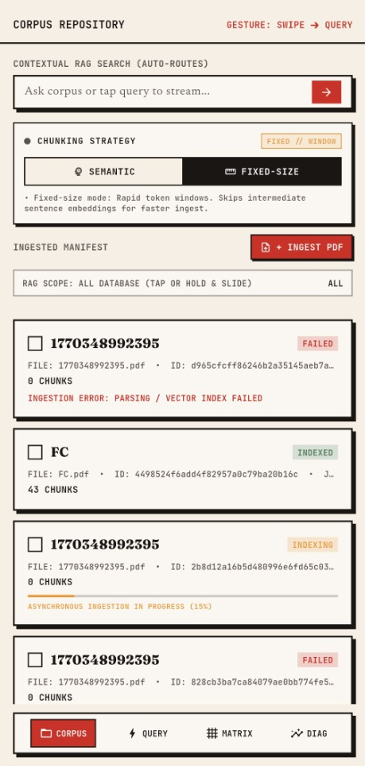

# SYNQRA // Neural Retrieval & Attribution Canvas

> **A high-performance, neo-brutalist Archival RAG mobile client built in Flutter. Features low-latency Server-Sent Events (SSE) streaming, granular document-scoped vector retrieval, grounded citation deep linking, and real-time agentic thought telemetry.**

---

<p align="center">
  <a href="https://flutter.dev"></a>
  <a href="https://dart.dev"></a>
  <a href="#design-system--visual-identity"></a>
  <a href="#authentication--clearance-ledger"></a>
  <a href="#testing--verification"></a>
  <a href="LICENSE"></a>
</p>

---

## 📱 Visual Showcase & Application Canvases

SYNQRA rejects sterile, opaque chatbots in favor of an **archival instrument** designed for intelligence analysts, researchers, and knowledge architects. Every state is tactile, high-contrast, and grounded in verifiable citations.

| 🚀 01. Typewriter Boot | 💬 02. Neural Query Canvas | 📚 03. Corpus Repository | 🧬 04. Vector Matrix | 📡 05. Graph Telemetry |
|:---:|:---:|:---:|:---:|:---:|
| <a href="docs/screenshots/01_archival_boot.png"></a> | <a href="docs/screenshots/02_query_canvas.png"></a> | <a href="docs/screenshots/03_corpus_repository.png"></a> | <a href="docs/screenshots/04_vector_matrix.png"></a> | <a href="docs/screenshots/05_graph_telemetry.png"></a> |
| **Terminal Daemon Init**<br>Typewriter kinetic boot animation with real-time vector mounting | **Attribution Canvas**<br>Live SSE token stream with interactive citation chips (`[1]`, `[2]`) | **Corpus & Ingestion**<br>PDF multipart uploads, chunking mode switch & slide scope selection | **Latent Space**<br>1536-D embedding manifold & per-chunk tensor inspection | **Real-Time Telemetry**<br>Dense/BM25 scores, HNSW topology & operator clearance |

---

## ⚡ Key Highlights (At a Glance)

- **⚡ Real-Time SSE Token Streaming**: Streams responses incrementally over HTTP Server-Sent Events with atomic chunk events and graceful HTTP fallback.
- **🎯 Grounded Interactive Citations**: References (e.g. `[1]`, `[2]`) are extracted via regex and rendered as interactive badges that open an evidence bottom sheet with document metadata, snippet text, and relevance scores.
- **🔬 Agentic Thought Timeline**: Surfaces every retrieval stage in real time (*Query Preparation → Embedding Generation → HNSW Traversal → Cross-Encoder Reranking → Synthesis*).
- **📂 Granular Multi-Document Scoping**: Tap a single PDF or slide across multiple cards to isolate vector retrieval to specific documents.
- **🔐 Native AWS Cognito Auth (Amplify SRP)**: In-app Secure Remote Password (SRP) authentication without external browser redirects or popups.
- **🏛️ Archival Neo-Brutalist Design**: Hard-edge brutalist offset shadows (`Offset(3, 3)`), warm parchment (`#F5EFE6`) & nocturne dark palettes, monospaced data readouts, and zero blurry bitmaps.

---

## 🧭 Table of Contents

- [📱 Visual Showcase & Application Canvases](#-visual-showcase--application-canvases)
- [⚡ Key Highlights (At a Glance)](#-key-highlights-at-a-glance)
- [🏛️ Application Canvases Walkthrough](#️-application-canvases-walkthrough)
  - [1. Terminal Daemon Boot Screen](#1-terminal-daemon-boot-screen)
  - [2. Query & Attribution Canvas](#2-query--attribution-canvas)
  - [3. Corpus Repository & Ingestion](#3-corpus-repository--ingestion)
  - [4. Vector Matrix Repository](#4-vector-matrix-repository)
  - [5. Telemetry & Graph Diagnostics](#5-telemetry--graph-diagnostics)
  - [6. Operator Clearance Dossier](#6-operator-clearance-dossier)
- [🏗️ Architecture Blueprint](#️-architecture-blueprint)
- [🌐 Backend API Integration](#-backend-api-integration)
- [🎨 Design Tokens & Typography](#-design-tokens--typography)
- [🚀 Quick Start Guide](#-quick-start-guide)
- [🧪 Testing & Verification](#-testing--verification)
- [⚙️ Configuration & Environment](#️-configuration--environment)
- [📄 License](#-license)

---

## 🏛️ Application Canvases Walkthrough

### 1. Terminal Daemon Boot Screen
The application initializes with a kinetic typewriter sequence that renders the `SYNQRA` banner character-by-character alongside a blinking vermilion block cursor (`▌`).
- Mounts latent vector manifold (1536-D).
- Calibrates HNSW graph & BM25 indices.
- Validates operator clearance ledger before routing into the primary interface.
- Includes a tactile `[ SKIP >> ]` bypass for returning researchers.

### 2. Query & Attribution Canvas
The core analysis work area combining natural language querying with full provenance:
- **Preset Inquiry Pills**: Instant exploration chips (`What is dense neural IR?`, `Explain 1536-D embedding projections`).
- **Live Token Streaming**: Real-time markdown rendering with mathematical formula formatting via KaTeX.
- **Interactive Citation Badges**: Tapping any inline citation marker (`[1]`, `[2]`) slides up an evidence sheet with the exact source text, page number, and similarity score.
- **Mini-Dock Navigation**: High-contrast bottom dock providing one-tap navigation across `CORPUS`, `QUERY`, `MATRIX`, and `DIAG`.

### 3. Corpus Repository & Ingestion
Manages the active research document collection:
- **Chunking Strategy Toggle**: Switch between `SEMANTIC` (sentence-aware embeddings) and `FIXED-SIZE` (rapid token windows).
- **Multipart PDF Ingest**: Uploads documents via `file_picker` to the indexing backend with live progress bars.
- **Scope Selector**: Select all documents, tap a single entry, or slide across multiple items to restrict retrieval to a specific subset.
- **Status Badges**: Visual state indicators (`INDEXED`, `INDEXING`, `FAILED`) with persistent local manifest caching.

### 4. Vector Matrix Repository
Allows operators to drill down into the latent embedding space:
- Browse extracted document chunks with reference hashes (e.g. `chk_784f_neural`).
- Inspect 1536-dimensional tensor projections, BM25 lexical token weights, and vector dispersion metrics.
- Verify cross-attention reranking scores across candidate text spans.

### 5. Telemetry & Graph Diagnostics
A dedicated diagnostic dashboard providing complete transparency into the retrieval engine:
- **Real-Time Latency Meter**: Breakdown of total retrieval latency (e.g. `167 ms`) vs. cross-encoder reranking overhead (e.g. `85 ms`).
- **Scoring Breakdown**: Dense cosine similarity score alongside sparse BM25 lexical scores and candidate pruning counts (`16 / 128`).
- **Knowledge Graph Topology**: Node and typed edge counts across pipelines, embedders, storage indices, and models.
- **Live Endpoint Status**: Active connection health to the production backend (`https://synqra-api.duckdns.org/questions/stream`).
- **Theme Switcher**: Instant toggle between Warm Parchment (Light) and Obsidian Nocturne (Dark).

### 6. Operator Clearance Dossier
Accessible via the header operator badge or the telemetry dossier button:
- Displays operator call sign (`ARCH-9942`) and researcher identity.
- Vector quota consumption meter (84% capacity utilization).
- Active security session ledger with AWS Cognito SRP session management and a one-tap `REVOKE ALL SESSIONS` logout button.

---

## 🏗️ Architecture Blueprint

SYNQRA is engineered according to **Clean Architecture** principles, maintaining decoupled boundaries across Domain, Data, Presentation, and Core layers:

```
┌────────────────────────────────────────────────────────────────────────┐
│                          PRESENTATION LAYER                            │
│  ┌─────────────────────────┐  ┌──────────────────────────────────────┐ │
│  │   Screens & Canvases    │  │        ChangeNotifier Providers      │ │
│  │  - ArchivalSplashScreen │  │  - RagSessionProvider                │ │
│  │  - RootShellScreen      │  │  - CorpusProvider                    │ │
│  │  - QueryCanvasScreen    │  │  - TelemetryProvider                 │ │
│  │  - IngestionScreen      │  │  - SettingsProvider                  │ │
│  │  - MatrixOverviewScreen │  └──────────────────────────────────────┘ │
│  │  - GraphTelemetryScreen │  ┌──────────────────────────────────────┐ │
│  │  - ClearanceAuthScreen  │  │        Neo-Brutalist Widgets         │ │
│  │  - UserProfileScreen    │  │  - ProcessTimelineCard / MiniDock    │ │
│  └─────────────────────────┘  │  - CitationBadge / EvidenceSheet     │ │
│                               │  - BrutalistContainer                │ │
│                               └──────────────────────────────────────┘ │
└────────────────────────────────────┬───────────────────────────────────┘
                                     │ consumes & triggers
┌────────────────────────────────────▼───────────────────────────────────┐
│                             DOMAIN LAYER                               │
│  ┌─────────────────────────┐  ┌──────────────────────────────────────┐ │
│  │      Domain Models      │  │         Repository Contracts         │ │
│  │  - RagStreamEvent       │  │  - IRagStreamRepository              │ │
│  │  - Citation             │  │  - ICorpusRepository                 │ │
│  │  - DocumentEntry        │  │  - ITelemetryRepository              │ │
│  │  - RagProcessStep       │  │  - IProfileSettingsRepository        │ │
│  │  - ProfileSettings      │  │  - ICognitoAuthRepository            │ │
│  └─────────────────────────┘  └──────────────────────────────────────┘ │
└────────────────────────────────────▲───────────────────────────────────┘
                                     │ implements
┌────────────────────────────────────┴───────────────────────────────────┐
│                              DATA LAYER                                │
│  ┌──────────────────────────────────────────────────────────────────┐  │
│  │  - RagStreamRepository (SSE EventSource parsing & HTTP fallback) │  │
│  │  - CorpusRepository (Multipart PDF upload & manifest persistence)│  │
│  │  - ProfileSettingsRepository (SharedPreferences persistence)     │  │
│  │  - CognitoAuthRepository (Amplify Auth Cognito SRP integration) │  │
│  │  - MockTelemetryRepository / MockVectorInspectorRepository       │  │
│  └──────────────────────────────────────────────────────────────────┘  │
└────────────────────────────────────┬───────────────────────────────────┘
                                     │ foundation
┌────────────────────────────────────▼───────────────────────────────────┐
│                              CORE LAYER                                │
│  - AppTheme (Parchment & Nocturne palettes, typography, borders)       │
│  - CitationParser (Regex token extraction & inline badge mapping)      │
│  - SmoothPageRoute (Tactile transitional routing)                      │
└────────────────────────────────────────────────────────────────────────┘
```

---

## 🌐 Backend API Integration

SYNQRA connects seamlessly to FastAPI RAG services over HTTPS.

| Endpoint | Method | Content-Type | Purpose |
|---|---|---|---|
| `/documents` | `POST` | `multipart/form-data` | Upload and chunk PDF documents into vector storage |
| `/documents` | `GET` | `application/json` | Retrieve active document manifest and chunk counts |
| `/questions/stream` | `POST` | `application/json` | Real-time SSE token stream with timeline events |
| `/questions` | `POST` | `application/json` | Standard non-streaming fallback retrieval |

### Live Production Configuration
- **Production Host**: `https://synqra-api.duckdns.org`
- **Streaming Endpoint**: `https://synqra-api.duckdns.org/questions/stream`
- **Ingestion Endpoint**: `https://synqra-api.duckdns.org/documents`

### Server-Sent Events (SSE) Protocol
```http
event: status
data: {"step": "vector_search", "message": "Querying HNSW graph index...", "done": false}

event: answer_chunk
data: {"chunk": "Topological surface codes arrange physical qubits..."}

event: citations
data: {"citations": [{"id": 1, "document_id": "doc-8f3a12bc", "filename": "quantum.pdf", "page": 4, "text": "Surface codes arrange physical qubits in a 2D square lattice..."}]}

event: done
data: {}
```

---

## 🎨 Design Tokens & Typography

SYNQRA adheres to a strict tactile Neo-Brutalist design system defined in `lib/core/theme/app_theme.dart`:

| Token | Parchment (Light) | Nocturne (Dark) | Description |
|---|---|---|---|
| **Background** | `#F5EFE6` (Warm Parchment) | `#121110` (Obsidian) | Root canvas background |
| **Surface** | `#EDE6DB` (Vellum) | `#1C1A18` (Smoked Charcoal) | Card surfaces, docks, and modal sheets |
| **Borders** | `#1A1918` (Solid Charcoal) | `#3D3833` (Warm Carbon) | High-contrast 1.5px - 2.5px solid strokes |
| **Accent / Vermilion**| `#FF4C29` (Vermilion) | `#FF5C38` (Vivid Vermilion) | Primary CTA buttons, badges, active tabs |
| **Success / Indexed** | `#2E7D32` (Forest) | `#4CAF50` (Emerald) | Completed indexing badges and OK status |
| **Text Primary** | `#121110` (Ink Black) | `#F2ECE4` (Parchment Cream) | Headlines, body copy, and data values |
| **Text Muted** | `#6B655E` (Archive Dust) | `#9E978F` (Nocturne Dust) | Telemetry codes, captions, and hashes |

- **Display Typography**: `GoogleFonts.fraunces()` / `GoogleFonts.newsreader()` — Editorial slab-serif character.
- **Code & Telemetry**: `GoogleFonts.jetBrainsMono()` — Monospaced precision for latency metrics and indices.
- **Tactile Brutalist Shadows**: Zero-blur directional drop shadows (`Offset(3, 3)`).

---

## 🚀 Quick Start Guide

### Prerequisites
- **Flutter SDK**: `>=3.7.0`
- **Dart SDK**: `>=3.7.0`
- **Target Platforms**: Android (API 26+), iOS (14+), or macOS Desktop

### 1. Clone & Resolve Dependencies
```bash
git clone https://github.com/your-username/Flutter-Project.git
cd Flutter-Project

flutter pub get
```

### 2. Configure Backend Endpoint
By default, SYNQRA automatically connects to the live production server at:
```
https://synqra-api.duckdns.org
```
If developing against a local FastAPI server, run port forwarding via ADB:
```bash
# Reverse port 8000 for physical Android device testing
adb reverse tcp:8000 tcp:8000
```

### 3. Build & Run
```bash
# Run on connected device or emulator
flutter run

# Build release APK
flutter build apk --release
```

---

## 🧪 Testing & Verification

SYNQRA enforces strict automated test verification covering stream parsers, state machines, and brutalist UI components:

```bash
# 1. Static code analysis (0 warnings / 0 errors)
flutter analyze

# 2. Automated test suite (39/39 passing)
flutter test
```

### Key Test Suites
- `test/cognito_auth_test.dart`: Validates AWS Cognito SRP sign-in, user registration, confirmation challenge, and session refresh.
- `test/rag_stream_repository_test.dart`: Verifies SSE chunk parsing, network timeouts, error event propagation, and HTTP fallback.
- `test/rag_session_provider_test.dart`: Tests state machine transitions (`idle` → `streaming` → `completed`), token counters, and step progression.
- `test/corpus_selection_test.dart`: Validates tap and slide range selection across document entries and query scoping payload generation.
- `test/citation_parser_test.dart`: Ensures regex extraction maps `[1]`, `[2, 3]` tags to source documents without syntax distortion.
- `test/widget_test.dart`: End-to-end widget tests for the 4-canvas shell, clearance ledger, and profile dossier.

---

## ⚙️ Configuration & Environment

Settings can be managed dynamically via `SettingsProvider` or configured directly in the **User Profile Dossier**:

| Setting | Default Value | Description |
|---|---|---|
| `productionEndpoint` | `https://synqra-api.duckdns.org` | Primary HTTPS backend host |
| `sseEndpoint` | `/questions/stream` | Path for streaming SSE retrieval |
| `documentsUrl` | `/documents` | Path for multipart document ingestion |
| `topK` | `5` | Maximum nearest-neighbor chunks retrieved |
| `enableDenseOnly` | `false` | When true, disables sparse BM25 hybrid ranking |
| `similarityThreshold`| `0.75` | Minimum cosine similarity cutoff score |
| `isNocturneMode` | `false` | Toggles between Warm Parchment and Nocturne Dark themes |

---

## 📄 License

Distributed under the MIT License. See [LICENSE](LICENSE) for more information.
