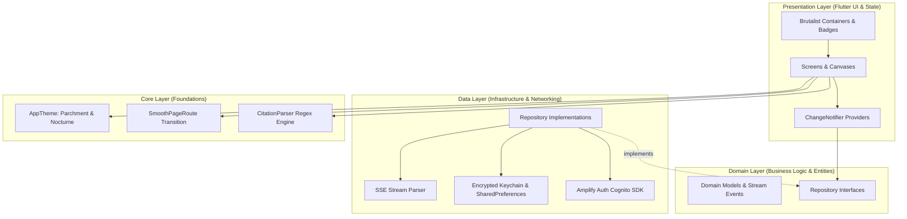

# Architecture Blueprint

SYNQRA follows **Clean Architecture** principles to enforce strict separation of concerns, high testability, and resilient state management.

---

## Architectural Layers

---

## 1. Presentation Layer

The presentation layer is built with Flutter declarative widgets coupled with `ChangeNotifier` providers managed via the `provider` package.

### Active Providers
- **`RagSessionProvider`**:
  - Manages query dispatch, token buffering, and SSE event streaming.
  - State machine: `idle` → `streaming` → `completed` (or `error`).
  - Maintains `ProcessTimelineStep` state to animate the agentic thought timeline.
- **`CorpusProvider`**:
  - Manages active document lists, chunking strategies (`semantic` vs. `fixed`), and file uploads.
  - Implements multi-document touch and drag-range selection logic.
- **`SettingsProvider`**:
  - Persists operator credentials, dark mode state, and backend endpoint URLs.
  - Interacts with `CognitoAuthRepository` to maintain live authentication state.
- **`TelemetryProvider`**:
  - Polling engine collecting retrieval latency metrics, knowledge graph node topologies, and memory health.
  - Exposes AWS CloudWatch operational state, recent audit buffer, and metric dispatch triggers.

---

## 2. Domain Layer

The domain layer contains pure Dart entities and abstract repository contracts with zero framework dependencies:

### Key Domain Models
- **`RagStreamEvent`**: Sealed class representing atomic stream messages:
  - `StreamStatusEvent`: Telemetry progress update (`step`, `message`, `done`).
  - `AnswerChunkEvent`: Incremental token chunk text.
  - `CitationsEvent`: List of grounded `Citation` entities.
  - `StreamErrorEvent`: Network or status error payload.
  - `StreamDoneEvent`: Stream completion signal.
- **`Citation`**: Source attribution entity containing `documentId`, `filename`, `page`, `snippetText`, and relevance score.
- **`DocumentEntry`**: File manifest entry tracking upload status, chunk count, file size, and indexing progress.
- **`ProfileSettings`**: Operator configuration including endpoints, theme preference, and clearance data.

### Abstract Repository Contracts
- `IRagStreamRepository`: Contract for Server-Sent Events query streaming and fallback.
- `ICorpusRepository`: Contract for document uploads, status polling, and manifest retrieval.
- `ICognitoAuthRepository`: Contract for AWS Cognito SRP authentication, registration, and logout.
- `ITelemetryRepository`: Contract for diagnostic metrics and graph statistics.

---

## 3. Data Layer

The data layer handles concrete networking, parsing, and storage implementations:

### Real-Time SSE Stream Parser (`RagStreamRepository`)
- Connects directly to `POST /questions/stream` using an HTTP streaming client.
- Parses line-by-line Server-Sent Events (`event: <type>`, `data: <json>`).
- Emits atomic `RagStreamEvent` objects onto a Dart `StreamController`.
- **Automatic Fallback**: If the SSE stream fails or returns `404 Not Found`, the repository automatically falls back to the standard non-streaming `POST /questions` endpoint.

### Encrypted Key-Value Persistence (`ProfileSettingsRepository`)
- Employs `SharedPreferences` for general configuration.
- Integrates `FlutterSecureStorage` (AES hardware keychain encryption) for bearer access tokens and refresh tokens.

---

## 4. Core Layer & Physics

- **`CloudWatchService`**: Core telemetry and audit service targeting AWS CloudWatch Logs (`/synqra/archival-rag`) and Metrics (`Synqra/MobileRetrieval`) in `ap-southeast-2`. Implements dynamic AWS SigV4 request signing and maintains a 60-event in-memory ring buffer for offline resilience.
- **`AppTheme`**: Centralized design token system providing Parchment (Light) and Nocturne (Dark) themes with custom typography and hard-edge brutalist shadows.
- **`CitationParser`**: High-performance regex parser that tokenizes answer strings, extracts `[1]`, `[2]`, `[1, 2]` patterns, and produces formatted spans with interactive badge triggers.
- **`SmoothPageRoute`**: Physics-based transitional routing implementing `Curves.easeInOutCubic` (260ms duration) with slide-and-fade physics for tactile transitions across canvases.
