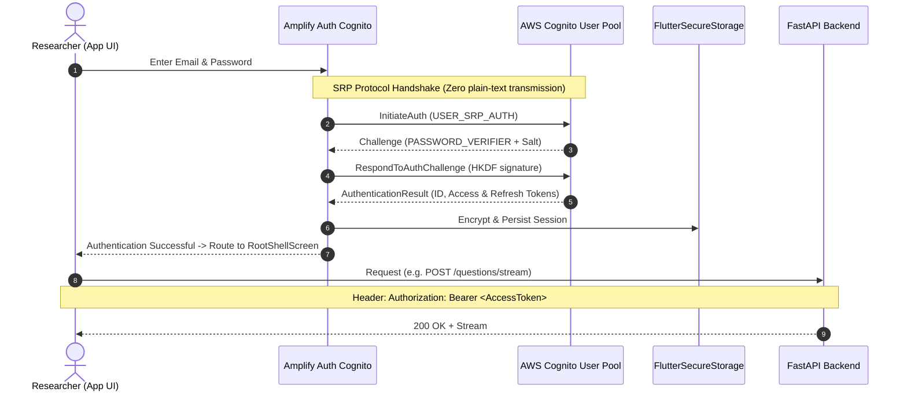

# Cognito Authentication & Clearance Ledger

SYNQRA incorporates **native, in-app authentication** powered by the official **AWS Amplify Auth Cognito** Flutter SDK. Authentication is performed directly through Cognito User Pool APIs using the **Secure Remote Password (SRP)** protocol, completely eliminating external browser redirects, popups, and managed login webviews.

---

## Configuration Details

| Parameter | Configuration Value |
|---|---|
| **AWS Region** | `ap-southeast-2` (Sydney) |
| **Cognito User Pool ID** | `ap-southeast-2_cR0iLu56D` |
| **Cognito App Client ID** | `4p3oehrll2pd9p1ann0gvubp1c` |
| **Authentication Flow** | `USER_SRP_AUTH` (Secure Remote Password) |
| **Token Storage** | Hardware-backed Keychain / Keystore (`FlutterSecureStorage`) |

---

## Secure Remote Password (SRP) Flow

---

## Core Authentication Features

### 1. In-App Sign-In
- Operator submits credentials on the **Archival Clearance Ledger** (`ClearanceAuthScreen`).
- Invokes `Amplify.Auth.signIn(username: email, password: password)`.
- If an email verification challenge is pending, the UI routes seamlessly to the verification code modal.
- On success, `SettingsProvider` updates researcher display names and call signs, then navigates to `RootShellScreen`.

### 2. In-App Registration & Confirmation
- Allows new operators to register directly within the app.
- Invokes `Amplify.Auth.signUp(...)`.
- Triggers verification code dispatch via AWS SES / Cognito.
- Operator enters the 6-digit confirmation code (`Amplify.Auth.confirmSignUp(...)`).
- Includes a one-tap `RESEND VERIFICATION CODE` action.

### 3. Password Recovery Flow
- Operator taps `Forgot Password?` on the login ledger.
- Invokes `Amplify.Auth.resetPassword(username: email)`.
- Operator enters the emailed reset code alongside their new password to finalize credentials.

### 4. Native Logout & Session Revocation
- Operator taps `REVOKE ALL SESSIONS` on the **Field Dossier** screen.
- Executes `Amplify.Auth.signOut()`.
- Purges in-memory and persistent token storage.
- Resets application state and smoothly routes the operator back to the Clearance Ledger.
- **No external browser redirects**: Avoids the deprecated browser-based `/logout` endpoint, preventing HTTP 400 redirect errors.

---

## Session Persistence & Token Refresh

- **Automatic Refresh**: The Amplify Auth SDK automatically rotates expired access tokens in the background using the Cognito refresh token.
- **Persistent Sessions**: Login state survives application restarts, cold boots, and background memory reclamation.
- **Sanitized Display Names**: User IDs (Cognito UUIDs) are parsed and sanitized; only researcher handles and formatted call signs (e.g. `ARCH-9942`) are displayed in the UI.
