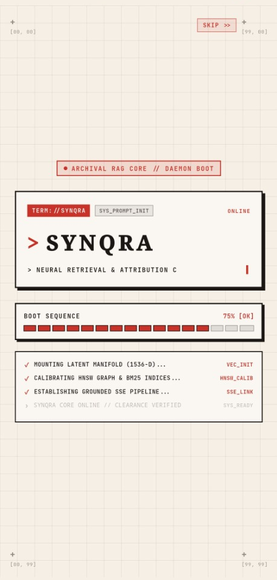
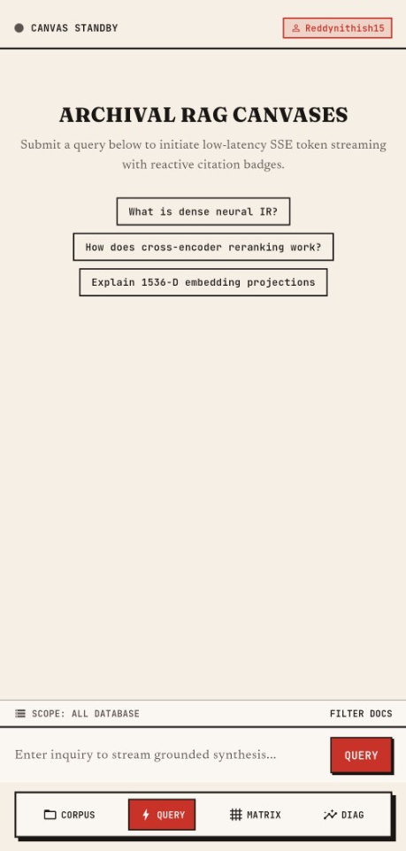
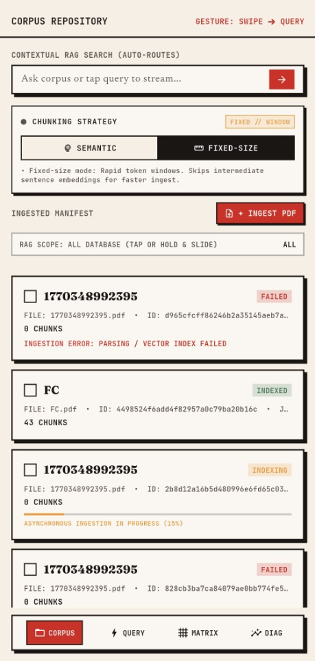
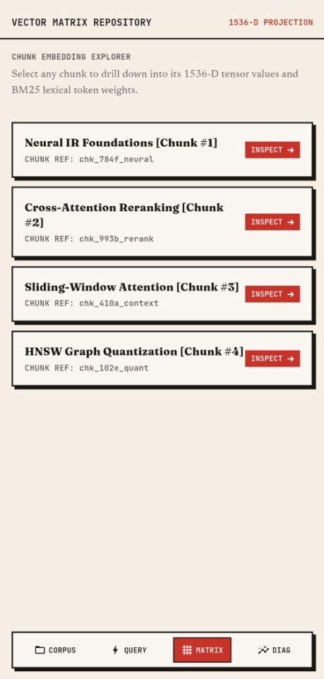
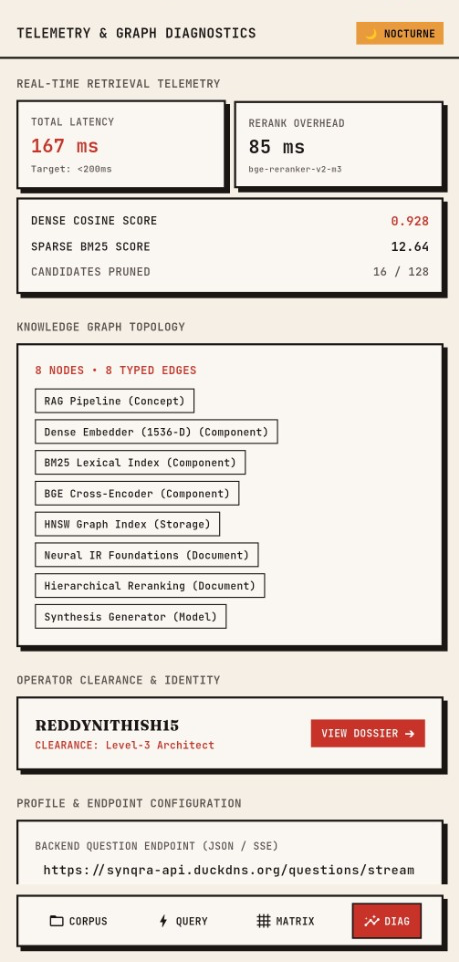

# Application Canvases Walkthrough

SYNQRA organizes the analyst workflow into dedicated canvases accessible via the brutalist **Mini-Dock** and tactile page transitions.

---

## 1. Terminal Daemon Boot Screen (`ArchivalSplashScreen`)

  

### Purpose & Functionality
The application initializes with an interactive typewriter terminal animation designed to set the archival research tone:
- **Kinetic Typewriter Header**: Renders the `SYNQRA` title character-by-character with a blinking vermilion block cursor (`▌`).
- **Telemetry Readout**: Simulates real-time system bootstrapping:
  - `MOUNTING LATENT MANIFOLD (1536-D)... [VEC_INIT]`
  - `CALIBRATING HNSW GRAPH & BM25 INDICES... [HNSW_CALIB]`
  - `ESTABLISHING GROUNDED SSE PIPELINE... [SSE_LINK]`
  - `SYNQRA CORE ONLINE // CLEARANCE VERIFIED... [SYS_READY]`
- **Bypass Gesture**: Operators can tap the `[ SKIP >> ]` chip in the upper right quadrant to bypass the animation immediately.
- **Routing Gate**: Evaluates `SettingsProvider.isAuthenticated`. If the operator has an active session, it navigates directly to `RootShellScreen`; otherwise, it directs to `ClearanceAuthScreen`.

---

## 2. Neural Retrieval & Attribution Canvas (`QueryCanvasScreen`)

  

### Purpose & Functionality
The primary research work area where operators dispatch natural language queries against dense document stores:
- **Preset Inquiry Pills**: Immediate exploration triggers (`What is dense neural IR?`, `How does cross-encoder reranking work?`, `Explain 1536-D embedding projections`).
- **Real-Time Token Streaming**: Text streams incrementally via Server-Sent Events (`POST /questions/stream`).
- **Formatted Markdown & Formulae**: Renders complex research prose, lists, code blocks, and mathematical equations with KaTeX.
- **Interactive Citation Badges**: Embedded markers such as `[1]` and `[2]` are hyperlinked directly. Tapping a badge triggers the **Evidence Bottom Sheet**.
- **Scope Pill Indicator**: Bottom bar displays the active query scope (e.g. `SCOPE: ALL DATABASE` or `SCOPE: 2 DOCS SELECTED`).

### Evidence Attribution Bottom Sheet (`EvidenceBottomSheet`)
When an operator taps an inline citation badge:
- Displays source document title and file ID.
- Surfaces specific page references and cosine relevance scores.
- Displays the exact extracted chunk context used by the synthesis generator.
- Includes a button to jump directly into the **Vector Matrix** for raw embedding tensor inspection.

---

## 3. Corpus Repository & Ingestion Canvas (`IngestionScreen`)

  

### Purpose & Functionality
Provides complete control over document ingestion, vector indexing, and dynamic query scoping:
- **Contextual Search**: Auto-routes direct questions entered in the corpus search bar to the retrieval engine.
- **Chunking Strategy Toggle**:
  - `SEMANTIC`: Sentence-aware dense chunking for complex research documents.
  - `FIXED-SIZE`: High-throughput token window chunking skipping sentence embeddings for faster ingest.
- **Multipart PDF Upload (`+ INGEST PDF`)**: Opens the device file picker to stream PDF files to `POST /documents`.
- **Slide & Tap Scope Selection**:
  - Tap any card to isolate queries strictly to that document.
  - Slide vertically across multiple cards to select a contiguous document range.
  - Toggle `ALL` to clear filters and query the entire corpus.
- **Status Ledger**: Real-time progress bars and status tags (`INDEXED`, `INDEXING (15%)`, `FAILED`).

---

## 4. Vector Matrix Repository Canvas (`MatrixOverviewScreen`)

  

### Purpose & Functionality
Allows knowledge architects to inspect the underlying high-dimensional vector representations:
- **1536-D Projection Explorer**: Drill down into chunk references (e.g. `chk_784f_neural`, `chk_993b_rerank`).
- **BM25 Lexical Weighting**: Inspect sparse token weights alongside dense vector embeddings for hybrid retrieval analysis.
- **Chunk Inspector Sub-Canvas (`ChunkInspectorScreen`)**: Displays raw chunk text, token distributions, and vector dispersion indices.

---

## 5. Telemetry & Graph Diagnostics Canvas (`GraphTelemetryScreen`)

  

### Purpose & Functionality
A comprehensive telemetry cockpit reporting backend performance and retrieval health:
- **Latency Breakdown**: Real-time measurement of total query turnaround (e.g. `167 ms`) versus cross-encoder reranking overhead (`85 ms`).
- **Manifold Scoring**: Cosine similarity metrics (`0.928`), BM25 sparse scores (`12.64`), and candidate pruning ratio (`16 / 128`).
- **Knowledge Graph Topology**: Visual summary of indexed nodes and typed edges across pipelines, embedders, indices, and documents.
- **Operator Clearance Badge**: Quick view of active identity (`Reddynithish15`, `Level-3 Architect`) with one-tap access to the **Field Dossier**.
- **Active Endpoint Status**: Verified link to production HTTPS endpoint (`https://synqra-api.duckdns.org/questions/stream`).
- **Theme Switcher**: Immediate toggle between Warm Parchment (Light) and Obsidian Nocturne (Dark).

---

## 6. Operator Clearance & Field Dossier (`UserProfileScreen`)

Accessible from the top header operator badge or via the **VIEW DOSSIER ➔** button on the Telemetry canvas:
- **Operator Call Sign**: Custom researcher handle and level badge.
- **Vector Quota Meter**: Visual percentage indicator tracking monthly embedding and token consumption.
- **Security Ledger**: Active session credentials managed by AWS Cognito SRP.
- **Session Revocation**: `REVOKE ALL SESSIONS` button executes native `Amplify.Auth.signOut()`, purges keychain tokens, and securely returns the operator to the Clearance Ledger.
