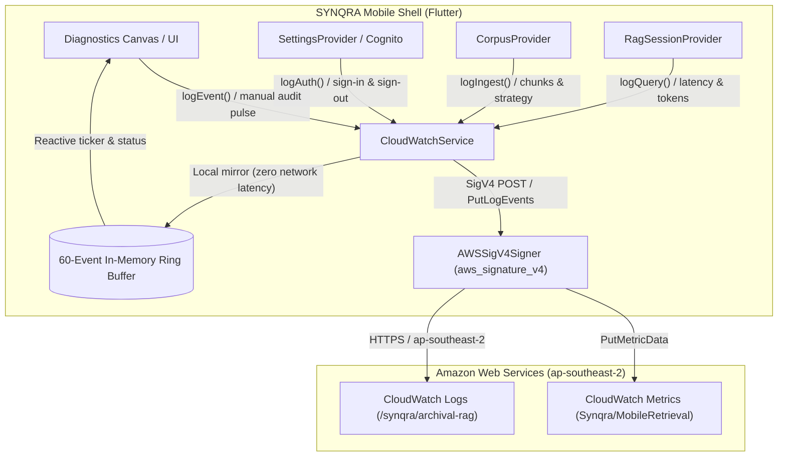

# AWS CloudWatch Telemetry & Audit Stream

SYNQRA integrates a production-grade **AWS CloudWatch Logs and Metrics** pipeline directly into the Flutter mobile shell. This enables real-time operational auditing, latency monitoring, retrieval scoring telemetry, and compliance tracking across distributed research sessions.

---

## Architecture Overview

The telemetry subsystem uses a **dual-dispatch architecture**:
1. **Live AWS SigV4 Dispatch**: Requests are signed using `aws_signature_v4` and `aws_common`, targeting CloudWatch endpoints (`logs.ap-southeast-2.amazonaws.com`) without hardcoded IAM credentials.
2. **In-Memory Ring Buffer**: Maintains a local circular buffer of the most recent 60 audit records and metrics, guaranteeing instantaneous diagnostics UI inspection and offline resilience if cellular or satellite connectivity drops.



---

## CloudWatch Specifications

| Parameter | Configuration | Description |
|:---|:---|:---|
| **AWS Region** | `ap-southeast-2` (Sydney) | Matches AWS Cognito User Pool `ap-southeast-2_cR0iLu56D` |
| **Log Group** | `/synqra/archival-rag` | Centralized archival audit and operational log group |
| **Log Stream Pattern** | `operator-[callSign]/YYYY-MM-DD` | Dynamic per-operator daily stream (e.g. `operator-ARCH-9942/2026-11-21`) |
| **Metrics Namespace** | `Synqra/MobileRetrieval` | CloudWatch Custom Metrics namespace |
| **Retention Policy** | Managed via AWS IAM / CloudWatch | Configurable retention on AWS Console |

---

## Log Event Format

All logs sent to CloudWatch Logs are structured as high-density JSON payloads containing UTC timestamps, log level, message, and metadata:

```json
{
  "timestamp": 1732190400000,
  "message": {
    "timestamp": "2026-11-21T12:00:00.000Z",
    "level": "INFO",
    "message": "RAG query completed successfully",
    "metadata": {
      "prompt_length": 34,
      "latency_ms": 167,
      "tokens_streamed": 42,
      "citations_count": 3,
      "success": true
    }
  }
}
```

### Log Levels
- `INFO`: Normal operational milestones (RAG queries, PDF ingestion, operator sign-in).
- `WARN`: User-cancelled streams, retried network attempts, unconfirmed accounts.
- `ERROR`: Retrieval failures, backend timeouts, document parsing exceptions.

---

## Custom CloudWatch Metrics

The following metrics are published to the `Synqra/MobileRetrieval` namespace:

| Metric Name | Unit | Dimensions | Description |
|:---|:---|:---|:---|
| `QueryLatency` | Milliseconds | `Operator`, `Status` | Roundtrip latency of grounded RAG query generation |
| `TokensStreamed` | Count | `Operator` | Total answer tokens streamed via SSE |
| `TotalLatency` | Milliseconds | None | Aggregated end-to-end pipeline latency |
| `DenseRetrievalScore` | None | None | Cosine similarity score of the top dense retrieval candidate |
| `SparseBM25Score` | None | None | Lexical BM25 score of retrieved chunk matches |
| `ChunksIngested` | Count | `Strategy` | Number of chunks produced during PDF corpus ingestion |
| `IngestionErrors` | Count | None | Corpus ingestion failure count |
| `AuditPulsePing` | Count | `Operator` | Manual operator heartbeat / diagnostic ping |

---

## Security & Identity Federation

> [!IMPORTANT]
> **Zero Hardcoded Credentials**: SYNQRA never embeds AWS IAM access keys, secret access keys, or bearer tokens in source code or mobile binaries.

1. **Cognito SRP Federation**: Users authenticate through AWS Cognito SRP (`ap-southeast-2`), receiving short-lived JWT tokens (`idToken`, `accessToken`, `refreshToken`).
2. **SigV4 Authorization**: Dynamic AWS Signature Version 4 signing is handled by `aws_signature_v4`, creating `AWS4-HMAC-SHA256` headers scoped to `ap-southeast-2` and service `logs`.
3. **Data Sanitization**: All logged metadata is sanitized to ensure tokens, passwords, and user passkeys are completely excluded from CloudWatch payloads.

---

## Diagnostics UI & Live Inspection

The **Telemetry & Graph Diagnostics** canvas (`lib/presentation/screens/graph_telemetry_screen.dart`) provides complete visibility into the CloudWatch subsystem:

- **Dispatch Status Badge**:
  - `ACTIVE // DUAL-DISPATCH`: Actively streaming to CloudWatch in `ap-southeast-2`.
  - `BUFFERING // LOCAL AUDIT RING`: Buffering events locally for inspection without network overhead.
  - `DISABLED`: Telemetry logging paused by operator.
- **Log Stream Details**: Displays active Log Group, Region, Stream Name, and total event counter.
- **Recent Audit Logs Ticker**: Scrollable live view showing the last 10 audit records with timestamp and level color-coding (Sage for INFO, Amber for WARN, Vermilion for ERROR).
- **Audit Pulse Button**: `⚡ DISPATCH CLOUDWATCH AUDIT PULSE` sends a verified test record and metric pulse to CloudWatch on demand.
