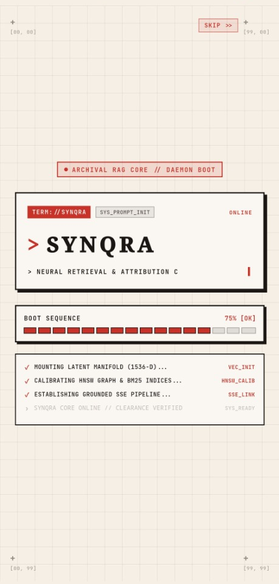
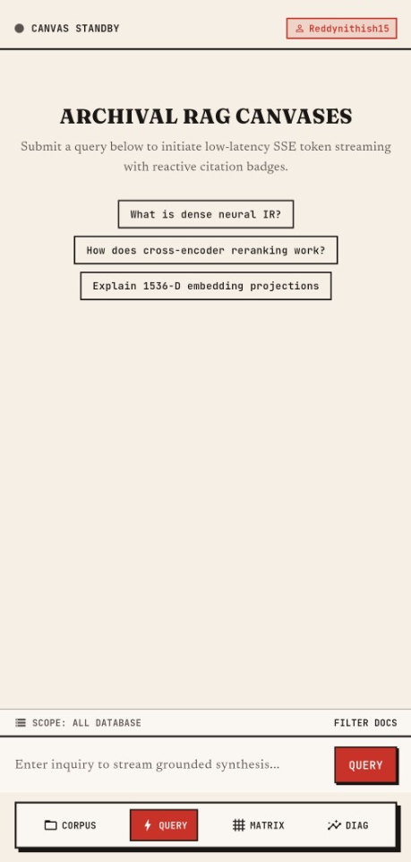
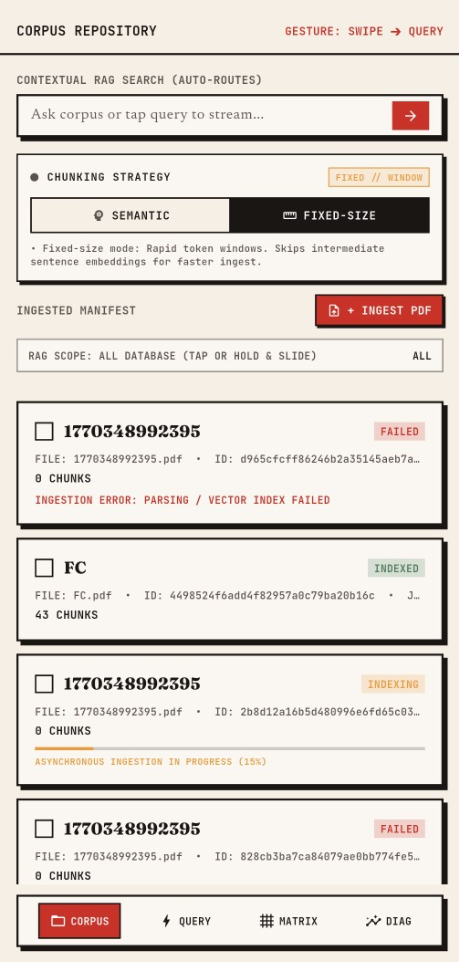
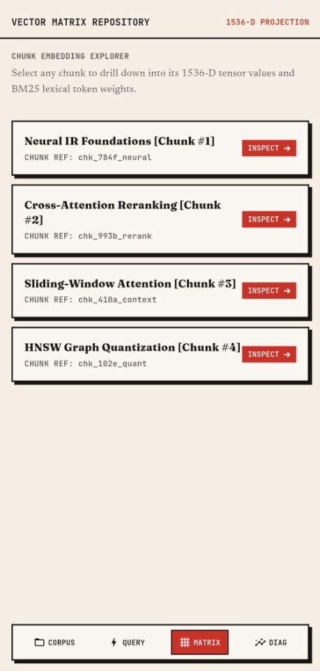
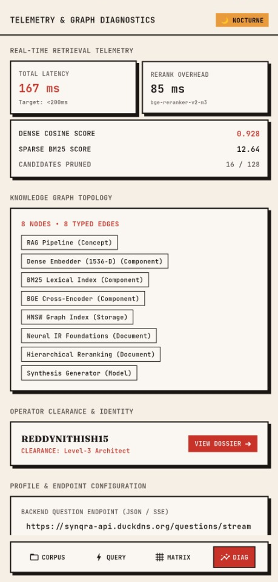

# SYNQRA // Neural Retrieval & Attribution Canvas

> **A high-performance, neo-brutalist Archival RAG client engineered in Flutter with low-latency Server-Sent Events (SSE) streaming, granular document-scoped vector retrieval, grounded citation deep linking, and real-time agentic thought telemetry.**

---

  
  
  
  
  
  

---

## Executive Summary

**SYNQRA** is an archival retrieval-augmented generation (RAG) mobile instrument built for researchers, intelligence analysts, and knowledge architects who require complete transparency, provenance, and attribution when querying dense document stores.

Unlike conventional chatbots that deliver opaque answers with vague references, SYNQRA treats document retrieval and synthesis as an observable scientific process:

- **Incremental Token Streaming**: Answers arrive over HTTP SSE with live token-per-second and millisecond latency telemetry.
- **Agentic Thought Timeline**: The full retrieval lifecycle—dense embedding generation, HNSW graph traversal, cross-encoder reranking, and context synthesis—is rendered as an interactive live timeline.
- **Interactive Grounded Citations**: Claims in generated answers are paired with clickable citation chips (`[1]`, `[2]`) that expand into grounded source text snippets, page references, and similarity metrics.
- **Multi-Document Scoping**: Flexible touch and slide gestures allow scoping inquiries across the entire corpus, a single PDF, or an arbitrary subset of files.
- **Zero-Browser SRP Authentication**: Direct AWS Cognito User Pool authentication using the Secure Remote Password (SRP) protocol without webviews or external browser redirects.
- **Archival Neo-Brutalist Visual Identity**: High-contrast tactile borders, zero-blur vector graphics, warm parchment and obsidian nocturne palettes, and typewriter terminal animations.

---

## Application Showcase

  

    
    <h4>01. Daemon Boot</h4>
    
Typewriter terminal init with live vector mounting

  

  

    
    <h4>02. Query Canvas</h4>
    
SSE token stream with interactive citation chips

  

  

    
    <h4>03. Corpus Ingestion</h4>
    
PDF upload, chunking strategy & slide scoping

  

  

    
    <h4>04. Vector Matrix</h4>
    
1536-D embedding manifold & tensor inspection

  

  

    
    <h4>05. Telemetry & Graph</h4>
    
Real-time retrieval latency & HNSW topology

  

---

## Core Capabilities Matrix

| Capability | SYNQRA Archival Mobile | Conventional Chat Interfaces |
|---|---|---|
| **Retrieval Visibility** | Real-time agentic timeline (*Embedding → HNSW → Reranking*) | Opaque spinner wheel |
| **Citation Attribution** | Interactive modal sheet with chunk text, page # & score | Unlinked plain numbers |
| **Document Scoping** | Touch & slide-range multi-document selector | Monolithic database query |
| **Streaming Protocol** | Native HTTP Server-Sent Events (SSE) with HTTP fallback | WebSockets or blocking JSON |
| **Authentication Flow** | AWS Cognito User Pool SRP (in-app, zero browser redirects) | Browser redirect / OAuth popup |
| **Visual Identity** | Neo-Brutalist Archival (Parchment & Nocturne) | Standard flat / minimalist white |
| **Security & Privacy** | AES-encrypted device keychain (`FlutterSecureStorage`) | LocalStorage / unencrypted cookies |

---

## Documentation Navigation

- [**Application Canvases**](canvases.md): Detailed visual and functional walkthrough of each screen.
- [**Architecture Blueprint**](architecture.md): Clean Architecture, Providers, SSE pipelines, and lifecycle.
- [**Cognito Authentication**](auth.md): Direct SRP login, registration, verification challenges, and session refresh.
- [**Backend API Contract**](api.md): Ingestion multipart specification, SSE event protocol, and error handling.
- [**Design System**](design-system.md): Color tokens, typography, brutalist shadow physics, and adaptive icons.
- [**Getting Started**](getting-started.md): Installation, ADB reverse port forwarding, and deployment to Google Pixel 8 Pro.
- [**Testing & QA**](testing.md): Automated test coverage, widget verifications, and static analysis results.
